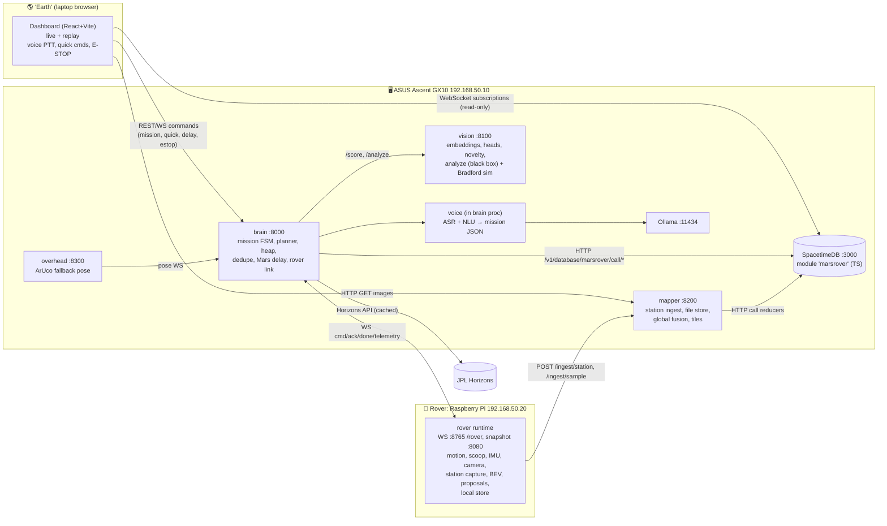

# 🔴 Ares Scout: a voice-tasked autonomous science rover (Cal Hacks)

> **One sentence, one science campaign.** You say *"Survey within a meter and a half, find the three most interesting rocks, sample them, and come home."* The rover then runs a small science campaign on its own. It **surveys** by spinning in place, **scores** every rock it sees, keeps the **top-k** in a heap, plans a **nearest-neighbor route**, drives to each rock, **scoops** it, holds it up to its camera for a (black-box) **analysis**, **drops** it, and **remembers where it has been** so it never revisits. Every decision is logged with a plain-language **reason**. All state streams into **SpacetimeDB**. One **dashboard** shows the run live, and after the run it replays the run on the **fused global map** the GX10 renders.

This repo is the team's **single ground truth**. Humans and coding agents both read it. Start with [AGENTS.md](AGENTS.md).

---

## Why this is different (our differentiator)

NASA's **AEGIS** (Automated Exploration for Gathering Increased Science) lets Curiosity and Perseverance pick ChemCam/SuperCam laser targets on board without Earth in the loop ([JPL AEGIS on Perseverance](https://doi.org/10.48577/jpl.nymwbh)). AEGIS chooses **one target from one image** and then points an instrument at it.

Ares Scout takes the same idea a few steps further, at hackathon scale:

| | AEGIS (real) | Ares Scout (ours) |
|---|---|---|
| Tasking | Pre-uplinked parameters | **Plain-language voice mission** → parsed JSON parameters |
| Targets per decision | 1 | **Top-k across a multi-station survey** (min-heap, deduped) |
| Movement | Points a mast instrument | **Plans and drives a multi-target route** (nearest neighbor) |
| Interaction | Remote laser (LIBS) | **Physical sampling**: scoop → present to camera → drop |
| Memory | n/a | **Visited set with exclusion radius**, stored in SpacetimeDB |
| Explainability | Ranked internally | **Per-target reason string** ("novel texture, pickable size, matches 'float rock'") |
| Calibration | Hand-tuned by the team | **Category priors from real scientist and AEGIS choices** in the public ChemCam master list ([docs/03](docs/03-space-data-and-training.md)) |
| Light-time | Real | **Mars delay mode**: real one-way light time from JPL Horizons, compressed for testing; e-stop always bypasses it |

## Features

- 🎙️ **Voice missions**: push-to-talk in the dashboard → ASR → LLM → a validated `mission` JSON. Text input is the fallback.
- 🔄 **Autonomous look-around**: rotate-in-place survey stations (8 × 45°) with one fixed camera. There is no head tracking and no pan servo ([why](docs/01-hardware-and-assembly.md#look-around-decision)).
- 🗺️ **Local maps on the rover**: each station produces keyframes, a bird's-eye-view (BEV) ground tile, a pose and rock proposals. These are stored on the Pi's SD card and uploaded to the GX10.
- 🌍 **Global map on the GX10**: pose-graph-refined fusion of all station tiles into a global mosaic. The mosaic is stored in SpacetimeDB and rendered in the dashboard.
- 🧠 **Science scoring**: `0.35·novelty + 0.25·visual + 0.15·pickable + 0.15·category − 0.10·distance`. It uses embeddings plus logistic-regression heads trained on real Mars data (MSL labeled set, AI4Mars) and ChemCam/AEGIS target-type priors.
- 🏔️ **Top-k min-heap, dedupe, nearest-neighbor route, exclusion radius**: the rover never re-samples a spot.
- 🥄 **2-servo scoop**: scoop → present → "analyze" (placeholder record, clearly labeled simulated) → drop → mark visited.
- 🧪 **Simulated Bradford protein assay per soil sample** (proof of concept, no wet lab). Each sample gets a deterministic simulated Coomassie G-250 assay, seeded by `sample_id` and biased by interest score. Replay shows a cuvette turning brown → blue, the simulated A595, a BSA standard curve with the sample plotted, the concentration in µg/mL and a verdict band. Real parameters come from vendor manuals: 595 nm, BSA standards 0–2000 µg/mL, linear range 125–1000 µg/mL ([P3 brief](docs/roles/P3-perception-ai.md#bradford-assay-simulator)). Every view is labeled **"SIMULATED — proof of concept"**.
- ⏯️ **Quick commands**: `pause`, `resume`, `stop`, `skip`, `status`, `come back`, plus an **E-STOP** that bypasses the delay.
- 🛰️ **Mars delay mode**: one-way light time from JPL Horizons, a compression slider, and the current real delay displayed.
- 📊 **One dashboard, two modes** ([spec](docs/06-dashboard.md)):
  - **Live**: pose and trail on the map as local tiles arrive, the mission and its parsed parameters, task queue and top-k with scores and reasons, visited circles, the latest keyframe, health, delay controls, connection status and E-STOP.
  - **Replay**: the fused global map, a scrubbable timeline, and click-a-pin for photo, score, reason, analysis and the simulated Bradford assay panel.
- 🗄️ **SpacetimeDB as the system of record** (sponsor track). It has a TypeScript module, and the dashboard is driven by subscriptions. Python services write through the documented HTTP reducer API ([docs/02](docs/02-spacetimedb.md)).
- 🪐 **Real space data** (SpaceXSI track): AI4Mars, the MSL Curiosity labeled set, the ChemCam master observation list (including AEGIS-selected targets), JPL Horizons, and the JPL raw-image feeds.

## Architecture



## Team (MECE ownership: every file, part and wire has exactly one owner)

| Who | Role | Owns |
|---|---|---|
| **P1** | Hardware (pure HW) | Chassis, motors, power, wiring harness, scoop mechanism, camera mast, IMU mount, ArUco markers, overhead camera stand, test arena, sample rocks, arena photo labels → [P1](docs/roles/P1-hardware.md) |
| **P2** | Rover runtime (hybrid) | Everything that runs on the Pi: motors, servos, IMU, camera, motion primitives, heading/VO, station capture, BEV local map, rock proposals, local store, uploader, safety; calibration; `gx10/overhead/` → [P2](docs/roles/P2-rover-runtime.md) |
| **P3** | Perception & AI (hybrid) | `ml/` training on space data, `gx10/vision/` (scoring + analyze), `gx10/mapper/` (ingest + global fusion), dashboard **map layer** `dashboard/src/map/`, the **simulated Bradford assay** end to end (`gx10/vision/bradford_sim.py` + `dashboard/src/assay/`) → [P3](docs/roles/P3-perception-ai.md) |
| **P4** | Brain & data lead (SW/backend) | Contracts, `shared/`, `gx10/brain/` (FSM, planner, heap, delay, rover link, voice ASR/NLU), `spacetimedb/` module, dashboard app shell and all panels except map and assay, integration, scripts → [P4](docs/roles/P4-brain-data.md) |

## Quickstart (once code exists)

```bash
# GX10 (192.168.50.10)
curl -sSf https://install.spacetimedb.com | sh               # SpacetimeDB CLI (aarch64 Linux build exists)
spacetime start --listen-addr 0.0.0.0:3000                     # foreground; separate terminal
./scripts/publish_stdb.sh                                      # publish module 'marsrover' to local
./scripts/gen_bindings.sh                                      # TS bindings → dashboard/src/module_bindings
./scripts/dev_up.sh                                            # brain:8000 vision:8100 mapper:8200 overhead:8300
# Pi (192.168.50.20)
cd rover && python -m rover.main --config calib/calib.yaml
# Laptop
cd dashboard && npm install && npm run dev                     # http://localhost:5173
```

Without hardware, `python mocks/fake_rover.py` stands in for the Pi. See [docs/04](docs/04-integration-timeline.md).

## Docs map

| Doc | What it is |
|---|---|
| [AGENTS.md](AGENTS.md) | Rules for humans and agents: ground truth, conventions, change control |
| [docs/00-overview-and-contracts.md](docs/00-overview-and-contracts.md) | **Contracts**: network, ports, frames/units, IDs, every JSON schema, timing, state machine |
| [docs/01-hardware-and-assembly.md](docs/01-hardware-and-assembly.md) | Full BOM by subsystem and location, power, pinout, scoop mechanics, assembly |
| [docs/02-spacetimedb.md](docs/02-spacetimedb.md) | SpacetimeDB design: tables, reducers, writers, subscriptions, commands, pitfalls |
| [docs/03-space-data-and-training.md](docs/03-space-data-and-training.md) | Public datasets (URLs, sizes, licenses) and what we train in 36 h |
| [docs/04-integration-timeline.md](docs/04-integration-timeline.md) | 36 h plan, integration milestones I0–I5, mocks |
| [docs/05-unknowns-and-risks.md](docs/05-unknowns-and-risks.md) | Unknowns (how and when to resolve) and risk register |
| [docs/06-dashboard.md](docs/06-dashboard.md) | Dashboard: stack, layout, components, data bindings, owners, tests |
| [docs/sources.md](docs/sources.md) | Every external source we relied on |
| [docs/TEAM.md](docs/TEAM.md) | Who is P1–P4, and the kickoff prompt each person gives their coding agent |
| [docs/roles/](docs/roles/) | One self-contained brief per person |

*Planned with Grok Bot; built with Cursor.*
