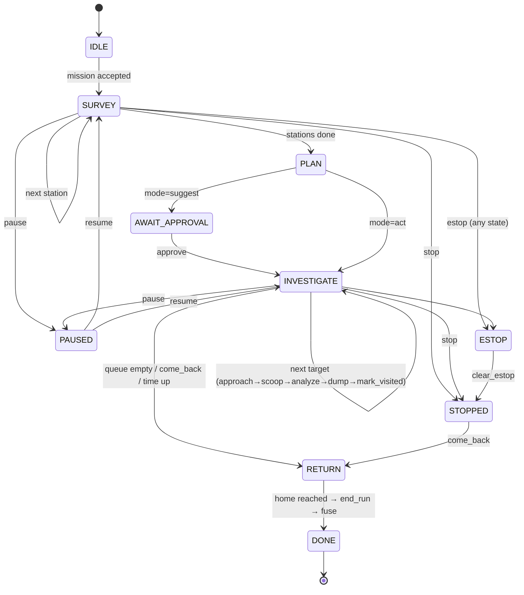

# 00: Overview and contracts (GROUND TRUTH)

> If code disagrees with this file, the code is wrong. Change process: [AGENTS.md §3](../AGENTS.md#3-changing-a-contract).

## 0. Version
`CONTRACT_VERSION = 1.2.0` (2026-10-24: removed the Mars delay mode in 1.1.0; mission parsing via Grok in 1.2.0)

## 1. System in one page

**Mission loop:**

1. **Uplink.** In the dashboard, the user speaks or types a mission. The brain parses it (Grok speech-to-text and parsing → `mission` JSON; offline backup: `faster-whisper` + regex) and starts the run.
2. **Survey.** The brain makes a station plan: home, plus extra stations if the radius is > 0.8 m. At each station the rover runs `station`: it spins 8 × 45°, captures a keyframe at each heading, builds a BEV local tile, finds rock proposals, saves everything on the SD card, and uploads it to the mapper.
3. **Score.** The brain sends proposal crops to vision `/score` and gets component scores. It computes the final score, dedupes, drops anything inside the visited exclusion radius, and pushes the rest into a min-heap. The heap is capped at k, so the root is the weakest of the current top-k.
4. **Plan.** The brain pops the top-k and orders it with a nearest-neighbor route from the current pose.
5. **Investigate** each target, in order:
   1. `approach`: visual servo into the scoop zone.
   2. `scoop`: deploy, push, curl, then present to the camera.
   3. Analyze: upload the image; vision `/analyze` returns a placeholder label/caption and a **simulated Bradford assay**.
   4. `dump`.
   5. `mark_visited` with its exclusion radius.
6. **Return** home, then `end_run`. The mapper runs global fusion and writes global tiles. The dashboard switches the run to replay.

Every state change is written to SpacetimeDB. The dashboard reads **only** SpacetimeDB (via subscriptions) plus static images from the mapper, and sends **commands only to the brain**.

### Who is authoritative for what
| Concern | Authority | Never |
|---|---|---|
| Rover actuation | Pi runtime (P2) executes primitives; refuses when estopped | Dashboard → Pi directly |
| Mission state, planning | brain (P4) | Dashboard writing DB rows that change behavior |
| Persistent state / history | SpacetimeDB (P4 module) | Services keeping private copies as truth (except Pi local store, which is a buffer + backup) |
| Images / big files | mapper disk `/data/runs/…` (P3), URLs in DB | Full-res images inline in DB |

## 2. Repo tree and owners (MECE)

```
ares-scout/
├── README.md                      P4
├── AGENTS.md                      P4
├── CLAUDE.md                      P4  (imports AGENTS.md for Claude Code)
├── Makefile                       P4  (make test / make lint / make up)
├── pyproject.toml                 P4  (ruff/black/pytest config only)
├── requirements-dev.txt           P4  (pytest, ruff, black)
├── .gitignore .editorconfig       P4
├── .python-version .nvmrc         P4  (3.11, Node 20)
├── docs/                          P4 (00, 02, 04, 05, 06, sources, TEAM.md); P1 (01); P3 (03); each Pn owns roles/Pn-*.md
│   └── requests/                  anyone (cross-owner change requests)
├── config/                        P4 except models.yaml
│   ├── network.yaml               IPs, ports (mirror of §3)
│   ├── run.yaml                   scoring weights, radii, k defaults (mirror of §8)
│   ├── models.yaml                P3  embedding model, Ollama caption model, model file paths
│   └── .env.example               STDB_URL, STDB_DB, STDB_TOKEN_BRAIN/_MAPPER (real .env gitignored)
├── shared/py/                     P4  (pip install -e shared/py on Pi + GX10)
│   ├── pyproject.toml
│   ├── tests/                     test_stdb_http.py, schema round-trips
│   └── marsrover_shared/
│       ├── version.py             CONTRACT_VERSION
│       ├── schemas.py             pydantic models for EVERY message in §6
│       ├── ids.py                 id generators (r_/m_/s_/k_/p_/c_/t_/v_/a_)
│       ├── frames.py              wrap_deg(), rover_to_mission(), mission_to_rover()
│       ├── stdb_http.py           StdbClient: call(reducer, *args), sql(query)
│       └── eventlog.py            append events.jsonl
├── hardware/                      P1
│   ├── bom.csv                    mirror of docs/01 BOM
│   ├── wiring/harness.md          as-built wiring photos + deviations
│   ├── scoop/                     templates (scoop_template.pdf/svg), photos, measured angles sheet
│   ├── arena/                     arena layout, marker placement
│   └── checklists/preflight.md    pre-run checklist
├── rover/                         P2  (runs on Pi)
│   ├── pyproject.toml
│   ├── rover/
│   │   ├── main.py                entry: loads calib, starts servers
│   │   ├── config.py              calib.yaml loader
│   │   ├── ws_server.py           WS :8765 /rover (cmd in; ack/done/err/telemetry/event out)
│   │   ├── snapshot_server.py     HTTP :8080 /snapshot.jpg, /stream.mjpg (debug)
│   │   ├── motors.py              TB6612 via gpiozero (lgpio)
│   │   ├── servos.py              PCA9685 channels, µs limits
│   │   ├── scoop.py               named poses + scoop sequence
│   │   ├── imu.py                 accel(/gyro) driver, auto-detect 0x68/0x53
│   │   ├── camera.py              OpenCV capture, fixed exposure
│   │   ├── motion.py              timed drive/turn primitives, gyro-closed turn if available
│   │   ├── heading.py             gyro integration + BEV visual-odometry yaw
│   │   ├── pose.py                dead-reckoning pose estimator + set_pose
│   │   ├── station.py             spin-capture routine
│   │   ├── bev.py                 homography → ground tile
│   │   ├── proposals.py           "rockster-lite" rock proposals (classic CV)
│   │   ├── approach.py            visual servo into scoop zone
│   │   ├── local_store.py         SD-card station bundles + SQLite index
│   │   ├── uploader.py            POST to mapper with retry queue
│   │   └── safety.py              heartbeat watchdog, estop latch, tilt cutoff
│   ├── calib/                     calibrate_motion.py, calibrate_camera.py, calibrate_scoop.py, calib.yaml
│   └── tests/
├── gx10/                          no shared files: each service dir has its own requirements.txt (same owner)
│   ├── brain/                     P4 (including voice/)
│   │   ├── requirements.txt
│   │   ├── settings.py            config/run.yaml loader (§8 constants)
│   │   ├── tests/                 unit tests + stub_rover.py (protocol stand-in until mocks/fake_rover.py)
│   │   ├── app.py                 FastAPI :8000 (REST + WS) – dashboard command API
│   │   ├── fsm.py                 run/mission state machine
│   │   ├── planner.py             station plan, heap top-k, NN route, replan on skip
│   │   ├── scoring.py             weighted score + explanation strings
│   │   ├── dedupe.py              spatial+embedding merge
│   │   ├── visited.py             exclusion-radius checks
│   │   ├── rover_link.py          WS client to Pi, cmd tracking, heartbeat
│   │   ├── overhead_link.py       subscribes to overhead :8300
│   │   ├── stdb_writer.py         rate-limited writes (poses, status) via StdbClient
│   │   ├── vision_client.py       vision /score + /analyze, mapper /fuse clients; priors loader
│   │   └── voice/                 P4  (ASR + NLU)
│   │       ├── requirements.txt
│   │       ├── asr.py             audio bytes → text (Grok STT; faster-whisper offline backup)
│   │       └── nlu.py             text → Mission (Grok structured output, regex fallback) + validation
│   ├── vision/                    P3
│   │   ├── requirements.txt
│   │   ├── app.py                 FastAPI :8100 /score /analyze /health
│   │   ├── embed.py               image → embedding (open_clip/SigLIP)
│   │   ├── heads.py               logistic-regression heads (visual, category, terrain)
│   │   ├── novelty.py             per-run embedding memory
│   │   ├── pickable.py            size/shape → pickable score
│   │   ├── analyze.py             placeholder analysis (VLM caption + label)
│   │   ├── scoop_check.py         empty-scoop detector (ROI diff)
│   │   └── bradford_sim.py        SIMULATED Bradford assay (deterministic)
│   ├── mapper/                    P3
│   │   ├── requirements.txt
│   │   ├── app.py                 FastAPI :8200 /ingest/* /fuse/* /files/*
│   │   ├── store.py               /data/runs/<run>/… layout
│   │   ├── fuse.py                global mosaic
│   │   ├── posegraph.py           2D pose graph refinement
│   │   └── tiles.py               slice → PNG → base64 → upsert_global_tile
│   └── overhead/                  P2
│       ├── requirements.txt
│       ├── app.py                 WS :8300 /pose
│       └── aruco_tracker.py
├── spacetimedb/                   P4  (TypeScript module "marsrover")
│   ├── package.json  tsconfig.json
│   └── src/ schema.ts  index.ts
├── dashboard/                     P4 except src/map/ and src/assay/
│   ├── package.json vite.config.ts index.html tsconfig.json .env.example
│   └── src/
│       ├── main.tsx App.tsx       shell, router (Live | Replay), providers
│       ├── styles.css vite-env.d.ts  global CSS variables; env typings
│       ├── stdb/                  connection.ts, hooks.ts (useRun, useRunTables)
│       ├── api/brain.ts           REST client to brain :8000
│       ├── module_bindings/       GENERATED (never hand-edit)
│       ├── panels/                MissionPanel, TaskQueuePanel, KeyframePanel, HealthPanel,
│       │                          ConnectionBadge, EStopButton, QuickBar,
│       │                          VoiceButton, TimelineScrubber, PinDetailDrawer, RunPicker, EventLog
│       ├── map/                   P3: MapView.tsx, layers/{tiles,trail,pins,exclusion,stations}.ts, camera.ts, map.css
│       └── assay/                 P3: BradfordPanel.tsx, Cuvette.tsx, StandardCurveChart.tsx, format.ts, assay.css, assay.test.ts
├── ml/                            P3  (data/ and models/ gitignored)
│   ├── requirements.txt
│   ├── download/                  get_msl_v21.py, get_ai4mars.py, get_chemcam_obs.py, get_raw_feed.py
│   ├── chemcam_priors.py          → ml/models/category_priors.json
│   ├── build_embeddings.py        → ml/models/*.npz
│   ├── train_heads.py             → ml/models/heads.joblib
│   ├── arena_fewshot.py           add arena photos to heads
│   └── eval.py
├── mocks/
│   ├── fake_rover.py              P2  (speaks §6.2 WS protocol, serves canned images)
│   ├── fake_vision.py             P3
│   ├── fake_mapper.py             P3
│   ├── fake_brain.py              P4  (scripted run → writes to STDB so dashboard can be built alone)
│   └── replay_run.py              P4  (re-plays events.jsonl into a fresh STDB db)
├── scripts/                       P4  _env.sh, dev_up.sh, publish_stdb.sh, gen_bindings.sh, reset_db.sh
└── data/                          gitignored; runtime (GX10 /data symlink)
```

**Seams where two owners meet.** Each one has exactly one rule:
- **Contract copies in role docs.** Each Pn owns `roles/Pn-*.md`, **except** its final "contract copies" section. Whoever changes a contract updates those copies (AGENTS.md §3, step 3).
- **Python deps.** Each service dir has its own `requirements.txt`, owned by that dir's owner. There's no shared GX10 dependency file.
- **Dashboard deps and styles.** `dashboard/package.json` and `src/styles.css` are P4's. P3 components only *read* the CSS variables, and keep their own styles in `map/map.css` / `assay/assay.css`. If P3 needs an npm dep, they request it in `docs/requests/` (doc 06 aims for no extra deps).
- **Dashboard ↔ map/assay.** `MapViewProps` and `BradfordPanelProps` (doc 06 §4) are the whole interface. P4 renders the components and passes rows; P3 never opens an STDB connection.
- **Model config.** `config/models.yaml` (vision/ML models) is P3's, and the only P3 file in `config/`. Voice settings (ASR size, Grok model) live in `config/run.yaml` (P4).
- **Arena photos.** P1 captures and labels them into `ml/data/arena/`. That's gitignored data, not repo files, in the layout docs/03 defines. P3 owns `arena_fewshot.py`, which consumes them.
- **Runtime `data/`.** The mapper (P3) owns the `data/runs/<run>/` layout. `eventlog.py` (P4) only appends `events.jsonl` in it.

## 3. Network and ports

Travel router **SSID `marsnet`**, subnet `192.168.50.0/24`, gateway `192.168.50.1`. Static DHCP leases:

| Host | IP | Link | Notes |
|---|---|---|---|
| Router | 192.168.50.1 | — | Internet uplink optional (e.g. phone hotspot as the router's WAN) for Grok voice; everything else is LAN-only |
| GX10 | 192.168.50.10 | Ethernet to router | All services; datasets pre-downloaded |
| Pi (rover) | 192.168.50.20 | Wi-Fi | Hostname `rover.local` as backup |
| Laptop (dashboard) | 192.168.50.30 | Wi-Fi | Browser + `npm run dev` |

| Port | Host | Service | Protocol | Owner |
|---|---|---|---|---|
| 8765 | Pi | rover runtime `/rover` | WebSocket JSON | P2 |
| 8080 | Pi | `/snapshot.jpg`, `/stream.mjpg` (debug only) | HTTP | P2 |
| 8000 | GX10 | brain: `/api/*` REST, `/ws/brain` | HTTP/WS | P4 |
| 8100 | GX10 | vision `/score` `/analyze` `/health` | HTTP JSON | P3 |
| 8200 | GX10 | mapper `/ingest/*` `/fuse/*` `/files/*` | HTTP | P3 |
| 8300 | GX10 | overhead `/pose` | WebSocket JSON | P2 |
| 3000 | GX10 | SpacetimeDB standalone (`spacetime start --listen-addr 0.0.0.0:3000`) | HTTP + WS | P4 |
| 11434 | GX10 | Ollama (optional captions only) | HTTP | P3 (model choice) |
| 443 | api.x.ai | Grok API: speech-to-text + mission parsing (internet; offline backup on the GX10) | HTTPS | P4 |
| 5173 | Laptop | dashboard dev server (Vite default) | HTTP | P4 |

CORS: brain, mapper and vision allow origin `http://192.168.50.30:5173` and `http://localhost:5173`.

## 4. Frames, units, timing

- **Mission frame M**: origin = center of the home pad (tape cross). +x = the direction the rover faces at run start (tape arrow). +y = left. z up (unused). Heading θ = CCW from +x, degrees, wrapped to (-180, 180] by `frames.wrap_deg`.
- **Rover frame R**: origin = rover geometric center projected to the ground (P1 marks it with a dot on the deck). +x forward, +y left.
- **Camera / BEV**: BEV tiles are **rover-frame** images at capture time: 1 px = `res_m_px` (default **0.005 m**), tile centered on the rover; image up = rover +x, image left = rover +y.
- **Units**: m, deg, s. `t` = unix seconds (float, `time.time()`). DB server timestamps come from `ctx.timestamp`, but every row also carries the producer's `t_unix` (f64).
- **Clock sync**: Pi and GX10 run `chrony` against the GX10 (GX10 = NTP server on the LAN). Tolerance 50 ms. ⚠️ UNVERIFIED that DGX OS ships chrony; `timedatectl` fallback.
- **Rates**: rover telemetry 5 Hz → brain; brain writes `pose` at 2 Hz and `rover_status` (upsert) at 2 Hz; dashboard renders at screen rate from cache.
- **Timeouts**: cmd ack ≤ 0.5 s; heartbeat from brain every 0.25 s; Pi stops motors if no heartbeat for 1.0 s **while moving**; `station` done ≤ 60 s; `approach` ≤ 45 s; `scoop` ≤ 30 s.

## 5. IDs
See [AGENTS.md §4](../AGENTS.md#4-conventions). The brain mints `r_ m_ t_ c_ v_ a_`; the Pi mints `s_ k_ p_` (they're scoped by `run_id`, which the brain sends in `start_run` cmd).

## 6. Schemas

All messages are JSON with the envelope `{"type": str, "t": float, "src": "brain"|"rover"|"dashboard"|"vision"|"mapper"|"overhead"}`. The pydantic source of truth is `shared/py/marsrover_shared/schemas.py`. Fields are required unless marked `?`.

### 6.1 Mission (brain ↔ voice NLU ↔ DB)
```json
{
  "mission_id": "m_0001",
  "run_id": "r_20261024_101500",
  "text": "Survey within a meter and a half, find the three most interesting rocks, sample them, and come back.",
  "radius_m": 1.5,
  "k": 3,
  "categories": ["float_rock", "layered", "veined", "any"],
  "sample": true,
  "return_home": true,
  "max_duration_s": 900,
  "mode": "act"
}
```
- Constraints: `radius_m` ∈ [0.3, 3.0]; `k` ∈ [1, 8]; `categories` ⊆ {`float_rock`, `layered`, `veined`, `sand`, `bedrock`, `pebble`, `any`}; `mode` ∈ {`act`, `suggest`}. In `suggest` mode the brain plans but waits for `approve`.
- When the NLU can't parse a field, it uses the default and lists it in `assumptions: [str]`.

### 6.2 Brain ↔ rover WebSocket (`ws://192.168.50.20:8765/rover`)

**Command** (brain → rover):
```json
{"type":"cmd","t":1761300000.12,"src":"brain","cmd_id":"q_000123","op":"drive","args":{"dist_m":0.30,"speed":0.5}}
```
| op | args | done.result |
|---|---|---|
| `start_run` | `{run_id}` | `{ok:true}` |
| `drive` | `{dist_m (±), speed 0–1}` | `{pose}` |
| `turn` | `{deg (±, CCW+), speed 0–1}` | `{pose, method:"gyro"\|"timed"}` |
| `stop` | `{}` | `{pose}` |
| `estop` | `{}` | `{latched:true}`, bypasses queue, also sent on a 2nd socket path if busy |
| `clear_estop` | `{}` | `{latched:false}` |
| `set_pose` | `{x,y,heading_deg,source}` | `{pose}` |
| `station` | `{station_id, n_views:8, step_deg:45}` | `StationResult` (6.4) |
| `approach` | `{cand_id, x, y}` (mission frame) | `{in_zone:bool, pose, offset_px:[dx,dy]}` |
| `scoop` | `{sample_id}` | `{present_image:"…/a_0001.jpg", uploaded:bool, pose}` |
| `dump` | `{}` | `{ok:true}` |
| `scoop_pose` | `{pose:"STOW"\|"DEPLOY"\|"CURL"\|"PRESENT"\|"DUMP"}` | `{ok:true}` |
| `snapshot` | `{}` | `{url}` |
| `heartbeat` | `{}` | (no ack) |

**Replies** (rover → brain): `{"type":"ack","cmd_id":…}`, `{"type":"done","cmd_id":…,"result":{…}}`, `{"type":"err","cmd_id":…,"code":"E_…","msg":"…"}`.

Error codes: `E_ESTOP`, `E_BUSY`, `E_TIMEOUT`, `E_BAD_ARGS`, `E_TILT`, `E_CAMERA`, `E_LOST_TARGET`, `E_UPLOAD`, `E_SCOOP`, `E_INTERNAL`.

**Telemetry** (rover → brain, 5 Hz):
```json
{"type":"telemetry","t":1761300000.4,"src":"rover",
 "run_id":"r_20261024_101500",
 "pose":{"x":0.42,"y":-0.10,"heading_deg":31.5,"source":"dr+gyro","sigma_xy_m":0.05},
 "state":"IDLE|MOVING|STATION|APPROACH|SCOOPING|ESTOP",
 "estop":false,
 "imu":{"ax":0.01,"ay":-0.02,"az":9.79,"gz_dps":0.4},
 "scoop":{"pose":"STOW","us":[1500,1500]},
 "cpu_temp_c":55.2,
 "queue_len":0,
 "uplink_backlog":0}
```
**Event** (rover → brain, ad hoc): `{"type":"event","kind":"tilt|bump|stall|upload_retry|camera_reset","detail":{…}}`.

### 6.3 Pose
`{"x": m, "y": m, "heading_deg": deg, "source": "dr"|"dr+gyro"|"vo"|"aruco"|"fused", "sigma_xy_m"?: m}`

### 6.4 Station upload (Pi → mapper `POST http://192.168.50.10:8200/ingest/station`, multipart)
Parts: `station.json`, `kf_000.jpg … kf_007.jpg`, `bev.png`, `crop_p_XXXX.jpg` (one per proposal).
```json
{
  "run_id":"r_20261024_101500","station_id":"s_0002","t":1761300100.0,
  "pose":{"x":0.8,"y":0.0,"heading_deg":0.0,"source":"dr+gyro"},
  "keyframes":[{"kf_id":"k_0009","file":"kf_000.jpg","heading_deg":0.0,"t":1761300101.2}],
  "bev":{"file":"bev.png","res_m_px":0.005,"w_px":360,"h_px":360,"frame":"rover@station"},
  "proposals":[{"prop_id":"p_0031","kf_id":"k_0010","bbox_px":[312,288,40,36],
                "crop":"crop_p_0031.jpg","xy":[1.12,0.21],"size_m":0.028,"contrast":0.41}]
}
```
`xy` is the mission frame (computed by the Pi from the pose and the BEV homography). Mapper reply: `{"ok":true,"station_id":"s_0002","stored":"/data/runs/r_…/stations/s_0002/","urls":{"bev":"http://192.168.50.10:8200/files/runs/r_…/stations/s_0002/bev.png","crops":{"p_0031":"…"}}}`.
The Pi includes the mapper reply in its `station` `done.result` (`StationResult = station.json + {"mapper": reply}`).

### 6.5 Sample upload (Pi → mapper `POST /ingest/sample`, multipart)
Parts: `sample.json` `{run_id, sample_id, cand_id, t, pose}` + `present.jpg`. Reply `{ok, url}`.

### 6.6 Vision `/score` (brain → vision)
Request `{"run_id":…, "items":[{"prop_id":"p_0031","crop_url":"…","size_m":0.028,"xy":[1.12,0.21]}]}`
Response:
```json
{"items":[{"prop_id":"p_0031",
  "visual":0.71,"novelty":0.64,"pickable":0.9,
  "category":"float_rock","category_probs":{"float_rock":0.55,"layered":0.2,"veined":0.05,"sand":0.05,"bedrock":0.1,"pebble":0.05},
  "terrain":"soil|bedrock|sand|big_rock",
  "embedding":[0.012, -0.03, "…", 0.08],
  "model":"siglip-b16+lr-v1"}]}
```
`embedding` is L2-normalized float list (dimension = model's; brain must not assume a fixed length).

### 6.7 Vision `/analyze` (brain → vision)
Request `{"run_id", "sample_id", "cand_id", "image_url", "interest_score": 0.0–1.0}`
Response `AnalysisResult`:
```json
{"sample_id":"a_0001","scoop_has_item":true,"label":"float_rock","confidence":0.62,
 "caption":"A small angular dark rock fragment with a smooth face.",
 "simulated":true,
 "assay": {
   "assay_type":"bradford_sim","simulated":true,"model_version":"bradford_sim-1",
   "seed":3896889563,
   "a595":0.2585,
   "concentration":282.1,
   "units":"µg/mL",
   "verdict":"low",
   "in_linear_range":true,
   "standard_curve_params":{
     "standard":"BSA","wavelength_nm":595,"linear_range":[125.0,1000.0],
     "true_model":{"type":"hyperbolic","amax":3.0,"k":3000.0,"noise_sd":0.01},
     "fit":{"type":"linear","slope":0.0007188,"intercept":0.0557,"r2":0.9947,"fit_range":[125.0,1000.0]},
     "blank_a595":-0.0068,
     "standards":[{"c":0,"a595":[0.0073,-0.0063,-0.001]},{"c":25,"a595":[0.0368,0.0404,0.0364]},
                  {"c":125,"a595":[0.1281,0.1487,0.134]}, "… 250, 500, 750, 1000, 1500, 2000 …"]
   }
 }}
```
Assay math and verdict bands: [P3 §Bradford](roles/P3-perception-ai.md#bradford-assay-simulator). The example is the real output of the reference simulator for `run_id=r_20261024_101500, sample_id=a_0001, interest_score=0.63`, so use it as a golden test vector. `seed` is a u32 so it survives JSON (SATS-JSON integers lose precision above 2^52). `verdict` ∈ {`below_detection`, `low`, `elevated`}.

### 6.8 Candidate (brain → DB; also returned by `/api/state`)
```json
{"cand_id":"c_0007","run_id":"…","station_id":"s_0002","prop_ids":["p_0031","p_0044"],
 "x":1.12,"y":0.21,"score":0.63,"novelty":0.64,"visual":0.71,"pickable":0.9,"category_score":0.55,
 "distance_m":1.14,"category":"float_rock","size_m":0.028,
 "status":"new|queued|active|visited|skipped|merged|excluded|failed",
 "rank":2,"thumb_url":"…","reason":"Novel texture (0.64), pickable size 2.8 cm, matches requested 'float_rock'; 1.1 m away."}
```

### 6.9 Task
`{"task_id":"t_0003","run_id","mission_id","kind":"station|visit|return","ref":"s_0002|c_0007|home","seq":3,"status":"pending|active|done|failed|skipped","note"?}`

### 6.10 Visit (sampled location)
`{"visit_id":"v_0002","run_id","cand_id","x","y","radius_m":0.20,"t","outcome":"sampled|empty_scoop|unreachable|skipped"}`

### 6.11 Dashboard → brain REST (`http://192.168.50.10:8000`)
| Method/path | Body | Effect |
|---|---|---|
| `POST /api/run/start` | `{notes?}` | new run_id, `start_run` |
| `POST /api/run/end` | `{}` | return home → end_run → fuse |
| `POST /api/mission/voice` | `audio/webm` body | ASR+NLU → mission |
| `POST /api/mission/text` | `{text}` | NLU → mission |
| `POST /api/approve` | `{mission_id, approve:bool}` | suggest-mode gate |
| `POST /api/quick` | `{cmd:"pause"\|"resume"\|"stop"\|"skip"\|"status"\|"come_back"}` | quick command; `stop` bypasses the FSM queue |
| `POST /api/estop` | `{}` | estop now, bypassing everything |
| `POST /api/estop/clear` | `{}` | clear latch |
| `GET /api/health` | — | `{brain, rover_link, vision, mapper, stdb, overhead}` each `"ok"\|"down"\|"degraded"` |

Every command returns `{"accepted":true,"cmd_uid":"u_…"}`.

### 6.12 Overhead pose (`ws://192.168.50.10:8300/pose`)
`{"type":"overhead_pose","t","src":"overhead","x","y","heading_deg","marker_id":0,"reproj_err_px":0.8,"visible":true}` at 10 Hz.

### 6.13 events.jsonl line
`{"t","run_id","src","level":"info|warn|error","kind":"…","msg":"…","data":{…}}`

## 7. Run state machine (brain)

`skip` = mark the active candidate `skipped`, add a visit with outcome `skipped` (so it's excluded), re-route.

## 8. Scoring, dedupe, heap, route, exclusion (constants live in `config/run.yaml`)
- `score = 0.35·novelty + 0.25·visual + 0.15·pickable + 0.15·category_score − 0.10·dist_norm`, `dist_norm = min(distance_m / radius_m, 1)`.
- `category_score = Σ_c category_probs[c] · prior[c] · want[c]`; `prior` from ChemCam/AEGIS target-type frequencies ([docs/03](03-space-data-and-training.md#chemcam-priors)), `want[c]=1` if c ∈ mission.categories or `any`, else 0.2.
- **Dedupe**: merge a new proposal into an existing candidate if `‖xy‖ ≤ 0.15 m` **and** `cos(emb) ≥ 0.85`; or `‖xy‖ ≤ 0.06 m` regardless. The merged candidate keeps the max score and appends `prop_ids`.
- **Exclusion**: drop/mark `excluded` any candidate within `visit_radius_m = 0.20` of any visit.
- **Heap**: a min-heap keyed by `score`, capped at `k`. On a new candidate: if size < k, push; elif score > heap[0], replace the root. Rebuilt after merge/skip/exclusion.
- **Route**: nearest-neighbor from the current pose over the heap contents; recomputed after each visit (pose drifts).
- **Reason string** (`scoring.explain`): the top 2 positive components with values + category match + distance, ≤ 140 chars.

## 9. Contract copies
Role docs end with copies of the parts they use. When you change this file, update those copies.
