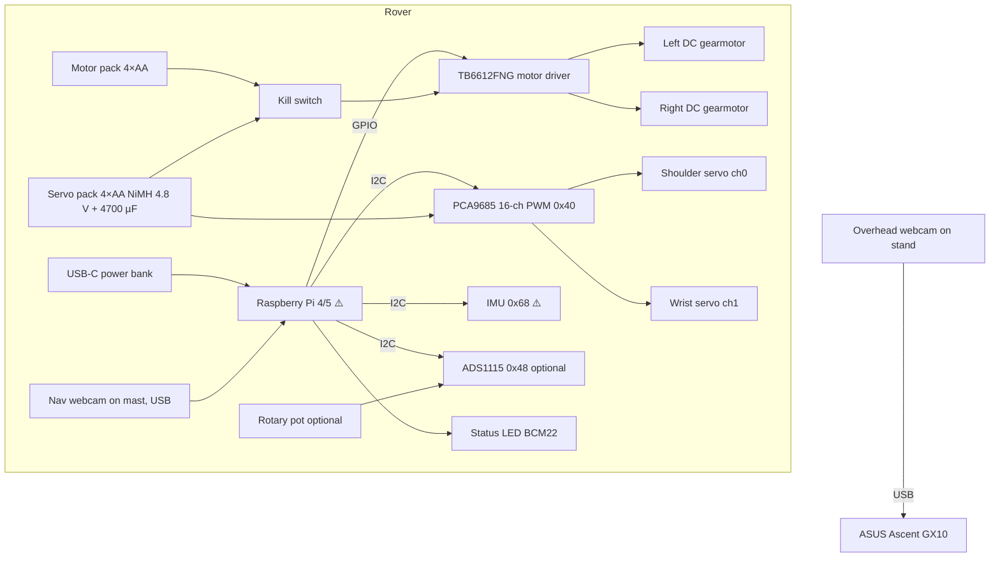

# 01: Hardware, mechanics and assembly

**Owner: P1.** P2 owns pin *assignments in code* (they must match §4 here). Changes go through [AGENTS.md §3](../AGENTS.md#3-changing-a-contract).

> **Prices**: only prices verified on the vendor page on 2026-10-23 are listed. "—" means no sourced price; don't guess. Kit items whose exact model we don't know yet are marked ⚠️ UNVERIFIED and are resolved first (see [05 U-1…U-8](05-unknowns-and-risks.md#unknowns)).

## 1. Look-around decision
<a id="look-around-decision"></a>

**Decision: no pan/tilt head and no head tracking. The rover looks around by rotating in place.** At each survey station it does 8 stops of 45° (360°) with **one fixed navigation camera on a mast, tilted down ~30–35°**.

Why:
1. **Both servos go to the scoop** (shoulder + wrist). A pan servo would cost us the wrist, or a third servo + rail current.
2. **The camera stays rigid relative to the scoop.** "Present to camera" always lands in the same pixel ROI, which makes `scoop_check` and the analysis photo trivial.
3. **No joint angle to track per detection.** Proposal → ground point needs only the chassis heading + one fixed homography, not a pan-angle chain.
4. Rotating in place is how real rovers do a cheap panorama too, but we don't claim parity.

Cost: heading error accumulates per turn. We mitigate it with gyro-closed turns (if the IMU has a gyro), BEV visual odometry (`cv2.estimateAffinePartial2D` on BEV features between consecutive views) and the overhead ArUco fallback.

### Stepper and rotary sensor: decision
| Part | Decision | Reason |
|---|---|---|
| Stepper motor (kit) | **Dropped** | No head, so it has no job. Too heavy and power-hungry for the scoop at this scale, and it would need its own driver. |
| Rotary sensor (kit, type ⚠️ UNVERIFIED) | **If it's a potentiometer: optional** scoop shoulder angle / ground-contact feedback via ADS1115 A0. **If it's a rotary encoder (detents, A/B pins): dropped.** | A pot on the shoulder axis tells us the scoop really reached DEPLOY (stalled on the ground = contact). An encoder knob can't be coupled to the shaft cleanly in 36 h. |
| Second webcam (kit) | **Overhead ArUco camera** on a stand, USB to the GX10 | Ground-truth/fallback pose. Gives the replay map an honest trail. |

## 2. System block diagram


## 3. Bill of materials

### 3a. By subsystem (each line: one owner = P1 unless stated; P1 procures and mounts, P2 drives it in code)
| # | Subsystem | Part | Qty | Have/Need | Unit price (source) | Notes |
|---|---|---|---|---|---|---|
| 1 | Compute | Raspberry Pi (4 or 5 ⚠️ U-1) + microSD ≥32 GB | 1 | HAVE (kit) | — | Pi 5: use `lgpio`/gpiozero, **not pigpio** (unsupported on Pi 5, [pigpio#589](https://github.com/joan2937/pigpio/issues/589)) |
| 2 | Compute | ASUS Ascent GX10 | 1 | HAVE | — | GB10, 20-core Arm, 128 GB unified, DGX OS ([ASUS techspec](https://www.asus.com/us/networking-iot-servers/desktop-ai-supercomputer/ultra-small-ai-supercomputers/asus-ascent-gx10/techspec/)) |
| 3 | Network | Travel router (any, 2.4/5 GHz) | 1 | NEED? ⚠️ U-9 | — | Venue Wi-Fi is unreliable; bring one |
| 4 | Drive | 2WD/4WD chassis + DC gearmotors (no encoders) | 1 set | HAVE (kit) | — | Ground clearance ⚠️ U-6 drives scoop geometry |
| 5 | Drive | TB6612FNG driver breakout | 1 | NEED if kit has none | $6.95 ([Adafruit #2448](https://www.adafruit.com/product/2448)) | ⚠️ UNVERIFIED current rating (read the Adafruit page/datasheet); compare against motor stall current |
| 6 | Scoop | Servo ×2 (kit model ⚠️ U-5) or SG92R | 2 (+2 spare) | HAVE? / NEED spares | SG92R $5.95 ([Adafruit #169](https://www.adafruit.com/product/169)) | Torque check §6.4 |
| 7 | Scoop | PCA9685 16-ch servo driver | 1 | NEED | $14.95 ([Adafruit #815](https://www.adafruit.com/product/815)) | Hardware PWM, offloads the Pi |
| 8 | Scoop | Arm: laminated popsicle sticks / basswood, M2–M3 screws, servo horns | — | HAVE/hackathon table | — | |
| 9 | Scoop | Scoop bucket: cut plastic spoon / cardboard / 3D print ~5×6×2.5 cm | 1 (+1) | MAKE | — | Template in `hardware/scoop/` |
| 10 | Sensing | Nav webcam (kit) | 1 | HAVE | — | Min focus distance ⚠️ U-7 (present pose must be in focus) |
| 11 | Sensing | Overhead webcam (kit, 2nd) + stand/tripod/tape to a pole | 1 | HAVE | — | ≥1.6 m up, sees the whole arena |
| 12 | Sensing | IMU (kit ⚠️ U-2), else MPU-6050 | 1 | HAVE? / NEED | MPU-6050 $12.95 ([Adafruit #3886](https://www.adafruit.com/product/3886)) | Must have a **gyro** for closed-loop turns |
| 13 | Sensing | ADS1115 ADC (only if rotary sensor is a pot) | 1 | OPTIONAL | $14.95 ([Adafruit #1085](https://www.adafruit.com/product/1085)) | |
| 14 | Sensing | Rotary sensor (kit ⚠️ U-4) | 1 | HAVE | — | See §1 decision |
| 15 | Power | 4×AA holder with switch (motors) | 1 | NEED | $2.95 ([Adafruit #830](https://www.adafruit.com/product/830)) | Alkaline 6 V nominal or NiMH 4.8 V |
| 16 | Power | 4×AA holder (servos) + 4× NiMH AA | 1 | NEED | holder $2.95 (#830) | 4.8 V nominal NiMH. **Not** 4× alkaline fresh (6.4 V) unless the servo is rated for 6 V+ |
| 17 | Power | 4700 µF 10 V electrolytic | 1 | NEED | $1.95 ([Adafruit #1589](https://www.adafruit.com/product/1589)) | Across PCA9685 V+ (the board has a footprint) |
| 18 | Power | 100 µF 16 V caps (×10 pack) | 1 pack | NEED | $1.95 ([Adafruit #2193](https://www.adafruit.com/product/2193)) | Motor-supply decoupling at TB6612 VM |
| 19 | Power | USB-C power bank ≥ 5 V 3 A (Pi 5 wants 5 V 5 A ⚠️) | 1 | HAVE (someone's) | — | Pi 5 may throttle/limit USB on 3 A |
| 20 | Power (alt) | Buck regulator for servos from a 2S pack | 1 | ALT only | D24V22F6 $27.95 ([Pololu #2859](https://www.pololu.com/product/2859)); D24V22F5 $26.95 (#2858); D36V50F6 $39.95 (#4092) | Only if we switch to a LiPo/2S pack |
| 21 | Safety | Inline SPST kill switch (or the #830 switch) | 1 | NEED | — | Cuts motor + servo packs, not the Pi |
| 22 | Wiring | Dupont jumpers, Wago/screw terminals, zip ties, heat-shrink, double-sided foam tape | — | HAVE/table | — | |
| 23 | Mapping | ArUco markers DICT_4X4_50: id 0 (rover top, 8 cm), ids 1–4 (arena corners, 12 cm), printed matte | 5 | MAKE | — | Measure the printed side length; enter in `overhead` config |
| 24 | Arena | ~3×3 m area, tape cross home pad + heading arrow, "Mars" ground (brown paper / sand tray), 15–25 rocks of mixed types, 6–10 **pickable** pebbles 1.5–3 cm | — | MAKE | — | Mars-like look narrows the domain gap ([03](03-space-data-and-training.md)) |
| 25 | Status | LED + 330 Ω resistor | 1 | HAVE/table | — | BCM22 |

### 3b. By location (where it physically lives)
| Location | Items (# from 3a) |
|---|---|
| Rover deck (bottom plate) | 4 chassis/motors, 5 TB6612, 15 motor pack, 21 kill switch, 18 caps |
| Rover deck (top plate) | 1 Pi, 7 PCA9685 + 17 cap, 12 IMU (**center, near the turning axis, flat**), 13 ADS1115, 16 servo pack, 19 power bank, 25 LED, 23 marker id 0 (on the very top, visible from above) |
| Rover front-left corner | 6 shoulder servo, 8 arm, 6 wrist servo, 9 scoop, 14 pot on shoulder axis (optional) |
| Rover mast (rear-center, ~18–22 cm tall) | 10 nav webcam, tilted 30–35° down, looking forward over the scoop |
| GX10 table | 2 GX10, 3 router, 11 overhead webcam cable |
| Above arena | 11 overhead webcam on stand |
| Arena | 23 corner markers, 24 rocks/pads |

## 4. Wiring and pinout (BCM numbering)

| Signal | Pi pin (BCM) | Phys pin | Goes to | Notes |
|---|---|---|---|---|
| I2C SDA | GPIO2 | 3 | PCA9685 SDA, IMU SDA, ADS1115 SDA | Shared bus, 3.3 V logic |
| I2C SCL | GPIO3 | 5 | PCA9685 SCL, IMU SCL, ADS1115 SCL | |
| PWMA | GPIO12 | 32 | TB6612 PWMA | Left motor speed (HW PWM capable) |
| AIN1 | GPIO5 | 29 | TB6612 AIN1 | |
| AIN2 | GPIO6 | 31 | TB6612 AIN2 | |
| PWMB | GPIO13 | 33 | TB6612 PWMB | Right motor speed |
| BIN1 | GPIO20 | 38 | TB6612 BIN1 | |
| BIN2 | GPIO21 | 40 | TB6612 BIN2 | |
| STBY | GPIO26 | 37 | TB6612 STBY | LOW = motors off (safety default) |
| LED | GPIO22 | 15 | LED via 330 Ω | |
| 3V3 | — | 1 | PCA9685 VCC, IMU VCC, ADS VCC, TB6612 VCC | Logic only |
| GND | — | 6/9/14… | **Star ground** point | |

**I2C addresses:** PCA9685 `0x40`, ADS1115 `0x48`, MPU-6050 `0x68` (a kit ADXL345 would be `0x53`, which is accel only ⚠️). Check with `i2cdetect -y 1` during inventory.

**PCA9685 channels:** ch0 shoulder, ch1 wrist, ch2–3 spare (spare SG92R pre-mounted on horns for a fast swap). V+ = servo pack (+4700 µF). **Never** power servos from the Pi 5 V pin.

**TB6612:** VM = motor pack (+100 µF), VCC = 3V3, A01/A02 → left motor, B01/B02 → right motor. If a motor spins backwards, swap its two wires (and tell P2 so `calib.yaml` stays truthful).

**Grounds:** Pi GND, TB6612 GND, PCA9685 GND, motor pack −, servo pack − all meet at **one** terminal (star ground).

### Power budget (estimates, not measured)
| Load | Supply | Note |
|---|---|---|
| Pi + webcam | Power bank | Pi 5 official PSU is 5 V 5 A ⚠️; a 3 A bank works with a USB current-limit warning |
| 2 DC gearmotors | Motor pack | Stall current unknown ⚠️; check the TB6612 per-channel rating on the datasheet ⚠️ UNVERIFIED |
| 2 servos | Servo pack | Stall spikes cause brownouts → the 4700 µF cap |

## 5. Mechanical layout
```
            TOP VIEW (front = up)                         SIDE VIEW (left side)
     ┌──────────────────────────────┐                 mast cam ◥ 30–35° down
  ⟵ S0 shoulder (front-left)        │                  │
  ┌─┼─┐ arm in x–z plane            │                  │ 18–22 cm
  │ scoop  offset 4–5 cm left of ℄  │          S0 ●────┼─── deck H_s ≈ 8 cm ⚠️
  └───┘                              │       L1 ╲      │
     │   [Pi]   [PCA]   [IMU ●]      │          ╲ S1●  │
     │          (center)             │           ╰scoop│
     │   [pack] [pack] [bank]        │  ════○════════════○════ ground
     │               ▲ mast rear-ctr │
     └──────────────────────────────┘
```

## 6. Scoop mechanics

### 6.1 Geometry (default numbers; P1 measures the real ones into `hardware/scoop/angles.md`)
- Shoulder axis height above ground **H_s ≈ 8 cm** (⚠️ depends on chassis U-6).
- **L1 ≈ 10 cm** shoulder → wrist (2–3 laminated popsicle sticks).
- **L2 ≈ 5 cm** wrist → scoop lip.
- Scoop bucket ~5 × 6 × 2.5 cm, open toward the front in DEPLOY.
- Shoulder angle θ1 measured from horizontal-forward, negative = down.

**Worked DEPLOY example:** we want the lip on the ground. With the wrist pointing the scoop flat-forward (θ2 relative so that L2 is horizontal): `H_s + L1·sin θ1 = 0.9 cm` (lip clearance) → `sin θ1 = −7.1/10` → **θ1 = asin(−0.71) ≈ −45.2°**, and the lip lands `L1·cos θ1 + L2 ≈ 7.0 + 5.0 ≈ 12.0 cm` ahead of the shoulder axis. P2 turns this "lip 12 cm ahead" into the pixel **scoop zone** during calibration.

### 6.2 Poses
| Pose | Shoulder | Wrist | Purpose |
|---|---|---|---|
| STOW | folded fully back/up | curled | Out of the camera FOV during driving and survey |
| DEPLOY | ≈ −45° | flat, lip down | Lip on the ground in front of the target |
| CURL | ≈ −40° | curl up 60–80° | Traps the pebble after a 4 cm push |
| PRESENT | ≈ +10…+30° | tilted toward the camera | Pebble inside the fixed camera ROI, in focus ⚠️ U-7 |
| DUMP | ≈ −20° | rotate down past 90° | Drops the sample in place |

Real µs values per pose are set by P2's `calibrate_scoop.py` and stored in `calib.yaml`; P1 records the mechanical stops.

### 6.3 Sequence (executed by P2's `scoop.py`, triggered by the brain)
1. `approach` until the target's pixel center is inside the calibrated **scoop zone** ROI.
2. DEPLOY → drive forward 4 cm at low speed → CURL.
3. PRESENT → capture `present.jpg` → upload to mapper `/ingest/sample`.
4. Brain → vision `/analyze` (placeholder analysis + `scoop_has_item` + simulated Bradford assay).
5. DUMP in place → STOW.
6. Brain `mark_visited(radius 0.20 m)`.
7. If `scoop_has_item=false`: retry **once** (back off 5 cm, re-approach). Then mark `empty_scoop`.

### 6.4 Torque sanity check
Payload + scoop + wrist servo ≈ 40 g (estimate) at r ≈ 12 cm → τ ≈ 0.040 × 9.81 × 0.12 ≈ **0.047 N·m ≈ 0.48 kg·cm** at the shoulder. Compare against the **real servo's datasheet stall torque** with a ≥2× margin. If the margin is short: shorten L1, use a lighter scoop, add a rubber-band counterbalance, or move the wrist servo closer to the shoulder.

## 7. Assembly (P1 order, with checkpoints)
1. **Inventory.** Photograph every kit part, read markings, fill U-1…U-8 in [05](05-unknowns-and-risks.md). Decide IMU/servo purchases.
2. **Chassis.** Build the chassis, mount motors, wheels. Mark the rover center dot. ✅ *CP1: wheels spin free, frame square.*
3. **Power.** Mount both AA packs + kill switch + star ground terminal. Fit the caps. ✅ *CP2: multimeter shows motor VM and servo V+ in range, kill switch kills both, Pi on its own bank.*
4. **Drive harness.** TB6612 per §4. Hand off to P2 for `motors.py` bring-up. ✅ *CP3: P2 drives both wheels both ways; STBY low stops them.*
5. **I2C deck.** PCA9685, IMU (flat, centered, arrow = +x forward), optional ADS1115. ✅ *CP4: `i2cdetect -y 1` shows 0x40, 0x68 (and 0x48).*
6. **Mast + camera.** Rigid mast rear-center, camera 30–35° down; **no wobble** (re-glue if it moves). ✅ *CP5: camera sees ground from ~10 cm ahead of the scoop lip to ≥1.5 m.*
7. **Scoop.** Cut the arm, mount the shoulder servo at the front-left, wrist + bucket, center the servos at 1500 µs before attaching horns. Optional pot on the shoulder axis. ✅ *CP6: hand-cycled all five poses, no collisions with the chassis or camera FOV in STOW.*
8. **Overhead + arena.** Stand at ≥1.6 m, markers 1–4 in the arena corners (measure positions in mission frame), rover marker 0 on top. Tape home pad + arrow. Lay out rocks + pebbles. ✅ *CP7: the overhead camera sees all 5 markers.*
9. **Hardening.** Strain-relieve cables, zip-tie, label every wire with its §4 signal name, spare servos ready. ✅ *CP8: 10 survey stations + 3 scoops in a row with no brownout or loose wire.*
10. **Pre-flight checklist** in `hardware/checklists/preflight.md` (batteries charged, kill switch, markers, SD space).

## 8. Watch-outs
- **Brownouts**: servo stall + Pi on a shared supply = reboot. Keep the supplies separate; share only ground.
- **Camera wobble** ruins the BEV homography. Re-calibrate after any mast change.
- **IMU near motors** picks up vibration; foam tape and put it at the center.
- **Scoop in the camera FOV during survey**: STOW must be fully out of frame.
- **Wheel slip** on smooth floors makes timed drives lie; the paper/sand arena helps.
- **Markers**: print matte, flat, measure the real side length; glare kills ArUco.
