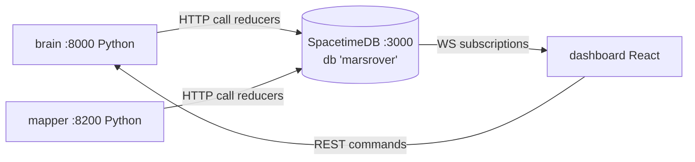

# 02: SpacetimeDB design

**Owner: P4** (`spacetimedb/`, `shared/py/marsrover_shared/stdb_http.py`, `scripts/*stdb*`). Every other service writes only through the reducers below.

Sources (verified 2026-10-23): docs https://spacetimedb.com/docs (full text snapshot `llms-full.txt`), CLI reference https://spacetimedb.com/docs/cli-reference, HTTP API https://spacetimedb.com/docs/http/database and /http/identity, SATS-JSON https://spacetimedb.com/docs/sats-json, file storage https://spacetimedb.com/docs/tables/file-storage, release **v2.13.0 (2026-10-21)** with an `aarch64-unknown-linux-gnu` build (https://github.com/clockworklabs/SpacetimeDB/releases).

## 1. Why SpacetimeDB, and the shape we use
- **System of record**: every run, pose, tile, candidate, visit and analysis (incl. simulated assay) is a row. Replay = reading old rows; no separate replay store.
- **Live UI for free**: the dashboard subscribes and gets inserts/updates pushed over WebSocket. No polling, no custom WS fan-out.
- **Writers are Python** (brain, mapper). The docs list client SDKs for C#, Rust, TypeScript and Unreal, **no Python SDK**, so Python calls reducers over the documented HTTP endpoint `POST /v1/database/:name/call/:reducer` (body = JSON array of args, `Authorization: Bearer <token>`). The docs note HTTP is not as optimized as WebSocket, so we **rate-limit**: pose ≤ 2 Hz, status ≤ 2 Hz, telemetry 1 Hz.
- **Dashboard is read-only on STDB.** Commands go to the brain (it owns safety). The dashboard never calls reducers.



## 2. Install, run, publish (GX10, ARM64)
```bash
curl -sSf https://install.spacetimedb.com | sh            # installs `spacetime` (do NOT `cargo install` the old 1.x crate)
spacetime version list                                     # expect 2.13.x
spacetime start --listen-addr 0.0.0.0:3000                 # foreground; default port 3000; no TLS in standalone
# module
cd spacetimedb && npm install
spacetime publish marsrover -s local -p . -y                                  # names: ^[a-z0-9]+(-[a-z0-9]+)*$
spacetime publish marsrover -s local -p . --delete-data=always -y            # schema reset (dev only!)
spacetime generate --lang typescript -o ../dashboard/src/module_bindings -p .
spacetime sql -s local marsrover "SELECT * FROM run"
spacetime logs -s local -f marsrover
```
- `ts-rules.mdc` (the SpacetimeDB agent rules file) says `--clear-database`; the current CLI reference says `-c/--delete-data <always|on-conflict|never>`. **Use `--delete-data=always`.** ⚠️ If it errors, run `spacetime publish --help` and update this line.
- Laptop CLI talking to the GX10: `spacetime server add --url http://192.168.50.10:3000 gx10` then `-s gx10`.
- **Fallback: Maincloud** (`spacetime login` then `spacetime publish marsrover --server maincloud`, clients use `https://maincloud.spacetimedb.com`). Only if the GX10 server fails; it needs internet and adds latency. Switching = change `STDB_URL` in `config/.env` and `VITE_STDB_URI`.
- `scripts/publish_stdb.sh` and `scripts/gen_bindings.sh` wrap the above (P4).

## 3. Naming rules (read this or lose an hour)
- Table `name` in options is the SQL/HTTP name (we use snake_case). Client accessors are camelCase (`ctx.db.localMapTile`, `tables.localMapTile` ⚠️ check generated `module_bindings/index.ts`).
- Row fields: declare **camelCase in TS** (`runId`). With the default case-conversion policy the canonical (SQL) name is snake_case (`run_id`). ✅ Verified on v2.13.0: **digits get their own underscore**, so `pngB64` → `png_b_64`, `thumbB64` → `thumb_b_64`, `a595` → `a_595` in SQL. Column names can't be overridden (explicit names exist only for tables, functions and indexes), so write SQL with these names. Python HTTP calls pass **positional arrays**, so field names don't matter there; SQL uses `run_id`.
- Reducer names come from the **export name**. We export snake_case (`insert_pose`) → HTTP path `/call/insert_pose`, TS client `conn.reducers.insertPose({...})` (unused, dashboard is read-only).
- Index names are verbatim: `<table>_<column>` (e.g. `pose_run_id`). Index names must be unique across the module.
- **No multi-column index filters** (the rules file reports them broken); filter on `run_id` then in code.

## 4. Type and encoding decisions
| Concern | Decision | Why |
|---|---|---|
| IDs | `t.string()` primary keys (`c_0007`) except high-volume rows (pose, telemetry, event, analysis) which use `t.u64().primaryKey().autoInc()` (insert with `0n`) | Human-readable joins; JSON-safe |
| Time | `tUnix: t.f64()` from the producer + `at: t.timestamp()` = `ctx.timestamp` | Replay scrubs on `tUnix`; server time for audit |
| Optional values | **Avoid `t.option` in reducer args**; use sentinels (`""`, `-1`, `NaN` not allowed: use `-1`) | Keeps the Python HTTP arg arrays trivial (SATS-JSON option = `{"some":v}`/`{"none":[]}`) |
| Integers over HTTP | Keep all values < 2^52 (u32 seeds, counters) | SATS-JSON integers are JSON numbers |
| Images | **Never full-res in the DB.** Keyframe thumbnails (≤ 320 px JPEG) and tiles (≤ 512 px PNG) as **base64 strings**; full-res on mapper disk, referenced by URL | File-storage doc: inline bytes are OK but large rows cost memory/bandwidth/commit time. Byte-array JSON encoding ⚠️ UNVERIFIED, base64 string sidesteps it |
| Structured blobs | JSON **strings** (`paramsJson`, `componentsJson`, `standardCurveParams`) | Schema-stable; parse in the dashboard |
| Writer identity | hex string | Avoids encoding `Identity` in HTTP args |

## 5. Tables (`spacetimedb/src/schema.ts`)
All tables `public: true` except `writer`. Every run-scoped table has a btree index `<table>_run_id`.

| Table | PK | Key fields | Written by (reducer) | Read by (dashboard component, [06](06-dashboard.md)) |
|---|---|---|---|---|
| `run` | `runId` str | status `active\|done\|aborted`, startedUnix, endedUnix, notes, fused bool | brain `start_run`/`end_run`, mapper `set_run_fused` | RunPicker, TopBar |
| `mission` | `key` str = `runId\|missionId` | missionId, runId, text, paramsJson, assumptionsJson, status `parsed\|active\|done\|rejected` | brain `upsert_mission` | MissionPanel |
| `task_queue` | `key` str = `runId\|taskId` | taskId, runId, missionId, kind, ref, seq u32, status, note | brain `upsert_task` | TaskQueuePanel |
| `pose` | `id` u64 autoInc | runId, tUnix, x, y, headingDeg, source, sigmaXy | brain `insert_pose` (2 Hz) | map trail layer, TimelineScrubber |
| `keyframe` | `key` str = `runId\|kfId` | kfId, runId, stationId, tUnix, x, y, headingDeg, thumbB64, url | mapper `upsert_keyframe` | KeyframePanel, PinDetailDrawer |
| `local_map_tile` | `key` str = `runId\|stationId` | stationId, runId, tUnix, x, y, headingDeg, resMPx f64, wPx, hPx, pngB64, url | mapper `upsert_local_tile` | map tiles layer (live) |
| `global_tile` | `tileId` str (`g_<run>_<ix>_<iy>`) | runId, ix, iy i32, originX, originY, resMPx, wPx, hPx, pngB64, version u32 | mapper `upsert_global_tile` | map tiles layer (replay) |
| `candidate` | `key` str = `runId\|candId` | candId, runId, stationId, x, y, score, componentsJson, category, sizeM, status, rank i32 (-1 = not in top-k), reason, thumbUrl, tUnix | brain `upsert_candidate` | TaskQueuePanel (top-k), map pins layer, PinDetailDrawer |
| `visit` | `key` str = `runId\|visitId` | visitId, runId, candId, x, y, radiusM, outcome, tUnix | brain `mark_visited` | map exclusion layer, PinDetailDrawer |
| `analysis_record` | `id` u64 autoInc | key = `runId\|sampleId` (unique idx), runId, sampleId, candId, visitId, tUnix, imageUrl, label, confidence, caption, scoopHasItem, **assayType, a595, concentration, units, verdict, inLinearRange, standardCurveParams, simulated, seed u32, modelVersion** | brain `add_analysis` | PinDetailDrawer, **BradfordPanel** (P3) |
| `telemetry` | `id` u64 autoInc | runId, tUnix, state, batteryV (-1 if unknown), cpuTempC, imuJson, scoopPose, uplinkBacklog | brain `insert_telemetry` (1 Hz) | HealthPanel |
| `rover_status` | `key` str = `"rover"` (single row) | runId, tUnix, state, estop bool, x, y, headingDeg, fsmState, activeCandId, linkOk bool, updatedUnix | brain `upsert_rover_status` (2 Hz) | ConnectionBadge, EStopButton state, HealthPanel, map rover glyph |
| `event` | `id` u64 autoInc | runId, tUnix, src, level, kind, msg, dataJson | brain/mapper `log_event` | EventLog, TimelineScrubber ticks |
| `writer` (private) | `identityHex` str | addedUnix, label | `claim_writer`, `add_writer` | — |

**Run-scoped keys (contract 1.4.0).** IDs like `c_0001` restart every run (00 §5), so the tables above whose ids restart are keyed by `key = "<runId>|<id>"`, built inside the reducers. Reducer args are unchanged; without this, a new run's `upsert_*` overwrote an earlier run's row with the same id. Look rows up by `key` (or filter by `runId`), never by the bare id.

### Bradford assay columns (Steering 2)
On `analysis_record`; all written in the **same** `add_analysis` call as the placeholder analysis, values copied verbatim from vision `/analyze` → `assay` ([00 §6.7](00-overview-and-contracts.md#67-vision-analyze-brain--vision)):

| Column | Type | Example | Notes |
|---|---|---|---|
| `assayType` | string | `"bradford_sim"` | `""` if no assay (empty scoop) |
| `a595` | f64 | `0.2585` | blank-corrected simulated absorbance at 595 nm |
| `concentration` | f64 | `282.1` | read back through the fitted BSA standard curve |
| `units` | string | `"µg/mL"` | |
| `verdict` | string | `"low"` | `below_detection\|low\|elevated` |
| `inLinearRange` | bool | `true` | false when outside 125–1000 µg/mL |
| `standardCurveParams` | string (JSON) | `{"standard":"BSA","wavelength_nm":595,…,"standards":[…]}` | everything the chart needs; no recomputation in the browser |
| `simulated` | bool | `true` | **always true**; the reducer rejects `false` |
| `seed` | u32 | `3896889563` | sha256(`run_id/sample_id`)[:4] |
| `modelVersion` | string | `"bradford_sim-1"` | bump when the simulator changes |

### schema.ts (sketch: shape is binding, formatting isn't)
```typescript
import { schema, table, t } from 'spacetimedb/server';

const runIdx = (tbl: string) => [{ name: `${tbl}_run_id`, algorithm: 'btree' as const, columns: ['runId'] }];

export const run = table({ name: 'run', public: true }, {
  runId: t.string().primaryKey(), status: t.string(), startedUnix: t.f64(), endedUnix: t.f64(),
  notes: t.string(), fused: t.bool(), at: t.timestamp(),
});
export const pose = table({ name: 'pose', public: true, indexes: runIdx('pose') }, {
  id: t.u64().primaryKey().autoInc(), runId: t.string(), tUnix: t.f64(),
  x: t.f64(), y: t.f64(), headingDeg: t.f64(), source: t.string(), sigmaXy: t.f64(),
});
export const candidate = table({ name: 'candidate', public: true, indexes: runIdx('candidate') }, {
  candId: t.string().primaryKey(), runId: t.string(), stationId: t.string(), x: t.f64(), y: t.f64(),
  score: t.f64(), componentsJson: t.string(), category: t.string(), sizeM: t.f64(), status: t.string(),
  rank: t.i32(), reason: t.string(), thumbUrl: t.string(), tUnix: t.f64(),
});
export const analysis_record = table({ name: 'analysis_record', public: true, indexes: runIdx('analysis_record') }, {
  id: t.u64().primaryKey().autoInc(), runId: t.string(), sampleId: t.string().unique(),
  candId: t.string(), visitId: t.string(), tUnix: t.f64(), imageUrl: t.string(),
  label: t.string(), confidence: t.f64(), caption: t.string(), scoopHasItem: t.bool(),
  assayType: t.string(), a595: t.f64(), concentration: t.f64(), units: t.string(), verdict: t.string(),
  inLinearRange: t.bool(), standardCurveParams: t.string(), simulated: t.bool(), seed: t.u32(),
  modelVersion: t.string(),
});
export const writer = table({ name: 'writer' /* private */ }, {
  identityHex: t.string().primaryKey(), addedUnix: t.f64(), label: t.string(),
});
// … mission, task_queue, keyframe, local_map_tile, global_tile, visit, telemetry,
//   rover_status, event exactly as in the §5 table.

const spacetimedb = schema({ run, mission, task_queue, pose, keyframe, local_map_tile, global_tile,
  candidate, visit, analysis_record, telemetry, rover_status, event, writer });
export default spacetimedb;
```
⚠️ The template-literal index helper must produce names unique per table (it does). If `t.string().unique()` + PK on another column misbehaves, drop `.unique()` and check in the reducer.

## 6. Reducers (`spacetimedb/src/index.ts`)
Arg order below **is the HTTP positional order** (camelCase names in TS; Python passes a list). Every reducer except `claim_writer` starts with `requireWriter(ctx)`.

| Reducer | Args (in order) | Behavior |
|---|---|---|
| `claim_writer` | `label: string` | If `writer` is empty, add `ctx.sender`. Else `SenderError`. Run once by `scripts/publish_stdb.sh`. |
| `add_writer` | `identityHex, label` | Writer-only: add another identity (mapper) |
| `start_run` | `runId, notes, tUnix` | Insert `run` status active; reject duplicate |
| `end_run` | `runId, status, tUnix` | Set endedUnix + status |
| `set_run_fused` | `runId, fused: bool` | |
| `upsert_mission` | `missionId, runId, text, paramsJson, assumptionsJson, status` | Insert or update |
| `upsert_task` | `taskId, runId, missionId, kind, ref, seq, status, note` | |
| `insert_pose` | `runId, tUnix, x, y, headingDeg, source, sigmaXy` | Append |
| `insert_telemetry` | `runId, tUnix, state, batteryV, cpuTempC, imuJson, scoopPose, uplinkBacklog` | Append |
| `upsert_rover_status` | `runId, tUnix, state, estop, x, y, headingDeg, fsmState, activeCandId, linkOk` | Single row key `"rover"`; sets `updatedUnix = tUnix` |
| `upsert_keyframe` | `kfId, runId, stationId, tUnix, x, y, headingDeg, thumbB64, url` | Reject `thumbB64.length > 150_000` |
| `upsert_local_tile` | `stationId, runId, tUnix, x, y, headingDeg, resMPx, wPx, hPx, pngB64, url` | Reject `pngB64.length > 700_000` |
| `upsert_global_tile` | `tileId, runId, ix, iy, originX, originY, resMPx, wPx, hPx, pngB64, version` | Replace if `version` ≥ existing |
| `upsert_candidate` | `candId, runId, stationId, x, y, score, componentsJson, category, sizeM, status, rank, reason, thumbUrl, tUnix` | Insert or full-row update (status/rank changes) |
| `mark_visited` | `visitId, runId, candId, x, y, radiusM, outcome, tUnix` | Insert visit; set candidate status to `visited`/`skipped`/`failed` per outcome |
| `add_analysis` | `runId, sampleId, candId, visitId, tUnix, imageUrl, label, confidence, caption, scoopHasItem, assayType, a595, concentration, units, verdict, inLinearRange, standardCurveParams, simulated, seed, modelVersion` | **Reject unless `simulated === true`**; reject `assayType` ∉ {`""`, `bradford_sim`}; reject verdict ∉ {`""`,`below_detection`,`low`,`elevated`}; idempotent on `sampleId` (update if exists) |
| `log_event` | `runId, tUnix, src, level, kind, msg, dataJson` | Append; truncate `msg` to 500 chars |

### index.ts (sketch)
```typescript
import spacetimedb from './schema';
import { t, SenderError } from 'spacetimedb/server';

function requireWriter(ctx: any) {
  const hex = ctx.sender.toHexString();           // ✅ verified on v2.13.0 (U-12)
  if (!ctx.db.writer.identityHex.find(hex)) throw new SenderError('not a writer');
}

export const claim_writer = spacetimedb.reducer({ label: t.string() }, (ctx, { label }) => {
  for (const _ of ctx.db.writer.iter()) throw new SenderError('writer already claimed');
  ctx.db.writer.insert({ identityHex: ctx.sender.toHexString(), addedUnix: 0, label });
});

export const insert_pose = spacetimedb.reducer(
  { runId: t.string(), tUnix: t.f64(), x: t.f64(), y: t.f64(), headingDeg: t.f64(), source: t.string(), sigmaXy: t.f64() },
  (ctx, a) => { requireWriter(ctx); ctx.db.pose.insert({ id: 0n, ...a }); });

export const add_analysis = spacetimedb.reducer({
  runId: t.string(), sampleId: t.string(), candId: t.string(), visitId: t.string(), tUnix: t.f64(),
  imageUrl: t.string(), label: t.string(), confidence: t.f64(), caption: t.string(), scoopHasItem: t.bool(),
  assayType: t.string(), a595: t.f64(), concentration: t.f64(), units: t.string(), verdict: t.string(),
  inLinearRange: t.bool(), standardCurveParams: t.string(), simulated: t.bool(), seed: t.u32(), modelVersion: t.string(),
}, (ctx, a) => {
  requireWriter(ctx);
  if (a.simulated !== true) throw new SenderError('analysis must be simulated=true');
  if (!['', 'bradford_sim'].includes(a.assayType)) throw new SenderError('bad assayType');
  if (!['', 'below_detection', 'low', 'elevated'].includes(a.verdict)) throw new SenderError('bad verdict');
  const existing = ctx.db.analysisRecord.sampleId.find(a.sampleId);
  if (existing) ctx.db.analysisRecord.id.update({ ...existing, ...a });
  else ctx.db.analysisRecord.insert({ id: 0n, ...a });
});
// … remaining reducers follow the same pattern. No Date.now(), no Math.random() (determinism).
```
Reducer arg order = object key order in the `{...}` params literal. ✅ Verified on v2.13.0 (U-11): HTTP positional arrays follow declaration order, so `stdb_http.py` uses positional arrays.

## 7. Writer auth flow
1. `curl -X POST http://192.168.50.10:3000/v1/identity` returns `{"identity": "...", "token": "..."}` ([docs](https://spacetimedb.com/docs/http/identity)). Do it twice: brain token, mapper token.
2. Put them in `config/.env` (`STDB_TOKEN_BRAIN`, `STDB_TOKEN_MAPPER`), never in git.
3. `publish_stdb.sh` calls `claim_writer` with the brain token, then `add_writer(<mapper identity>, "mapper")`.
4. The dashboard connects **without** a writer token (anonymous identity), so it can read public tables but every reducer refuses it.
5. After `--delete-data`, repeat step 3 (the writer table is wiped).

## 8. Python writer (`shared/py/marsrover_shared/stdb_http.py`)
```python
class StdbClient:
    def __init__(self, base_url: str, db: str, token: str, timeout_s: float = 2.0): ...
    def call(self, reducer: str, *args) -> None:
        """POST {base}/v1/database/{db}/call/{reducer} with json=list(args), Bearer token.
        Raises StdbError(status, body). Non-2xx is an error. Retries 2x on connection errors only."""
    def sql(self, query: str) -> list[dict]:
        """POST {base}/v1/database/{db}/sql, body = query text. For tests/debug only."""

class RateLimitedWriter:
    """Coalesces: keeps the latest value per key and flushes at hz (pose 2, status 2, telemetry 1).
    Runs in a background thread with a bounded queue; drops oldest on overflow and log_event('stdb_backpressure')."""
    def __init__(self, client: StdbClient, hz: dict[str, float]): ...
    def submit(self, key: str, reducer: str, *args) -> None: ...
```
- **Never call STDB on the control path.** The brain's FSM must not block on a DB write; writes go through a queue. If the DB is down, the rover keeps going and the events.jsonl log is the backup (`mocks/replay_run.py` can re-insert it).

## 9. Subscriptions (dashboard, `dashboard/src/stdb/`)
- One `DbConnection` for the app, memoized: `.withUri(import.meta.env.VITE_STDB_URI ?? 'ws://192.168.50.10:3000').withDatabaseName('marsrover')`.
- **Global (always):** `tables.run`, `tables.roverStatus`.
- **Per selected run** (re-subscribe when the RunPicker changes): `tables.<x>.where(r => r.runId.eq(runId))` for mission, taskQueue, pose, keyframe, localMapTile, globalTile, candidate, visit, analysisRecord, telemetry, event.
- React: `useTable(tables.candidate.where(r => r.runId.eq(runId)))` returns `[rows, isReady]`.
- Live vs replay use the **same subscriptions**; replay filters client-side by `tUnix ≤ scrubT`.
- Keyframe/tile **base64 is heavy**. Live mode: subscribe to `localMapTile` + `keyframe` for the current run only. If bandwidth hurts, add an anonymous view `keyframe_meta` without `thumbB64` (stretch).

Per-component mapping: [06 §5](06-dashboard.md#5-components-owners-and-data-bindings).

## 10. Volumes (estimate for a 15-min run)
| Table | Rows | Size |
|---|---|---|
| pose | 1,800 | small |
| telemetry | 900 | small |
| keyframe | 8 × ~6 stations = 48 | ~48 × 30 KB = 1.4 MB |
| local_map_tile | ~6 | ~6 × 200 KB = 1.2 MB |
| global_tile | ~16 | ~3 MB |
| candidate | 20–80 | small |
| analysis_record | ≤ 8 | ~8 × 3 KB |

Fine for an in-memory DB on 128 GB. Across many test runs: `scripts/reset_db.sh` before the final run.

## 11. Pitfalls
- BigInt: `u64` fields are BigInt in TS (`0n`). Don't `JSON.stringify` rows with BigInt.
- Timestamps on the client: `row.at.microsSinceUnixEpoch` (BigInt). We use `tUnix` (f64) for the UI to avoid this.
- `.insert()` returns the row, not an id. Updates need the **full row** (spread the existing row first).
- Indexes go in the **options** (first arg) of `table()`, with `algorithm: 'btree'`.
- Reducers: no network, no random, no clock except `ctx.timestamp`.
- Regenerate bindings after **every** schema change, or the dashboard silently shows stale fields.
- `spacetime call` and `spacetime dev` are marked unstable in the CLI reference: use HTTP from scripts, not `spacetime call`, in automation.
- HTTP handlers / procedures are beta; we don't need them.

## 12. Acceptance tests (P4)
1. `spacetime publish` succeeds on the GX10; `spacetime sql -s local marsrover "SELECT * FROM run"` returns 0 rows.
2. `pytest shared/py/tests/test_stdb_http.py` against a local server: `claim_writer`, `start_run`, `insert_pose` ×100, `sql` count = 100.
3. A call with no token (or the dashboard identity) to `insert_pose` fails with a sender error.
4. `add_analysis` with `simulated=false` is rejected; with the golden assay vector from [00 §6.7](00-overview-and-contracts.md) it round-trips exactly (`seed`, `a595`, `concentration`).
5. Dashboard receives `onInsert` for a pose within 500 ms of the HTTP call on the LAN.
6. 2 Hz pose + 2 Hz status + 1 Hz telemetry for 15 min: no backlog in `RateLimitedWriter`, STDB memory stable.
